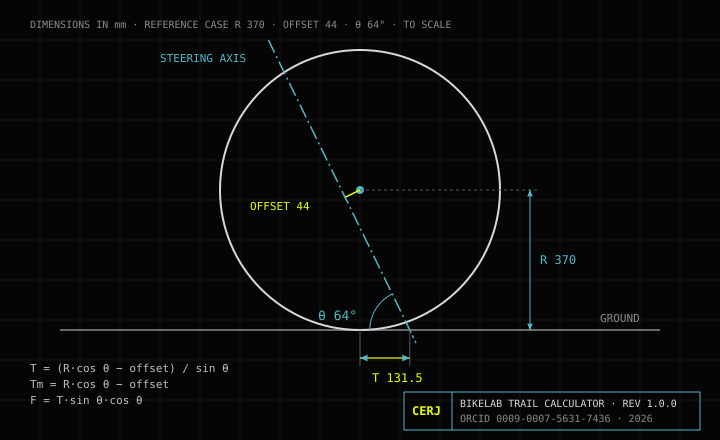

# BikeLab Trail Calculator

Designed and maintained by **Carlos Eduardo Ravello Joo** · ORCID [0009-0007-5631-7436](https://orcid.org/0009-0007-5631-7436) · BikeLab Studio, Trujillo, Peru

[](https://github.com/carlosravello-png/bikelab-trail-calculator/actions/workflows/verify.yml)
[](LICENSE.md)
[](https://doi.org/10.5281/zenodo.24477625)

Bicycle steering geometry from head angle, fork offset and wheel radius: ground trail,
mechanical trail, wheel flop, the sensitivity of trail to each input, and the change of
trail when the fork compresses. This repository holds the calculation engine, its golden
vectors and two independent verifiers. The green badge above is set by GitHub Actions,
which runs both verifiers on every change.



**Live demo:** https://carlosravello-png.github.io/bikelab-trail-calculator/
**Full calculator** (online since 22 June 2026): [ES](https://www.bikelabstudio.com/articles/calculadora-trail-geometria-es.html) · [EN](https://www.bikelabstudio.com/articles/trail-calculator-en.html) · [PT](https://www.bikelabstudio.com/articles/calculadora-trail-geometria-pt.html)
**Method and validation:** [trail-model-validation-en](https://www.bikelabstudio.com/articles/trail-model-validation-en.html)

## Model

Head angle θ measured from the horizontal, R = wheel radius to the ground, offset = fork rake.

| Quantity | Formula | Reference case (R 370, offset 44, θ 64°) |
|---|---|---|
| Ground trail | (R·cos θ − offset) / sin θ | 131.5 mm |
| Mechanical trail | R·cos θ − offset | 118.2 mm |
| Wheel flop | ground trail · sin θ · cos θ | 51.8 mm |
| +1° slacker | ∂trail/∂θ = (offset·cos θ − R) / sin²θ | +7.6 mm |
| +10 mm wheel diameter | ∂trail/∂D = ½ cot θ | +2.4 mm |
| Front compression (travel 160, sag 30 %, wheelbase 1250) | Δθ = arctan(travel·sag·sin θ / wheelbase) | θ 66.0°, trail 116.7 mm |

Sign guard: under front compression the head angle must steepen and trail must drop.

## Reproduce

```
python verify_trail.py     # independent verifier, standard library only
node check_engine.js       # the real engine, Node.js 18+
```

Each prints `N/N checks passed` and exits with code 0.

| File | What it is |
|---|---|
| `trail_engine.js` | The engine, copied byte for byte from the live page on 2026-11-23 (SHA-256 of the copied block in its header). Only a module footer was added. |
| `golden_vectors.json` | The vectors the published page checks itself against on every load. |
| `verify_trail.py` | Verifier written from the published equations, not from the JavaScript. |
| `check_engine.js` | Runs the engine against the golden vectors, the closed form on a 4,464-input grid, and the page's self-test. |
| `index.html` | Live demo of the same engine. |

## Honest notes

- The original 2026 oracle script was not preserved. `verify_trail.py` was written on
  2026-11-23 to replace it and is declared as such.
- Writing that verifier caught one error in the method article: it said "+10 mm of
  diameter → +4.9 mm of trail". The correct value is +2.4 mm (4.9 mm is what 10 mm of
  *radius* gives). The calculator always showed 2.4; the article was corrected in ES, EN
  and PT on 2026-11-23.
- This repository covers the engine and its evidence. The text of the bikelabstudio.com
  pages stays under the site's own license.

## License and citation

Engine, vectors and verifiers: [PolyForm Noncommercial 1.0.0](LICENSE.md), free for any noncommercial use,
including research, teaching and personal use; commercial use needs written permission from
the author. Versions up to 1.0.0 were released under CC BY 4.0 and keep that licence.
Licence and attribution terms: https://carlosravello.com/licencia-en.html. Cite with the metadata in
[`CITATION.cff`](CITATION.cff); each release is archived on Zenodo with its own DOI.

> Ravello Joo, C. E. (2026). *BikeLab Trail Calculator* (Version 1.1.0) [Software]. Zenodo. https://doi.org/10.5281/zenodo.24549760

All versions: DOI [10.5281/zenodo.24477625](https://doi.org/10.5281/zenodo.24477625). Code of version 1.1.0 archived in Software Heritage: [swh:1:rev:0f3e8b91f00cc60b2f8eb00eb3fdcd6f2cc7bd75](https://archive.softwareheritage.org/swh:1:rev:0f3e8b91f00cc60b2f8eb00eb3fdcd6f2cc7bd75).
